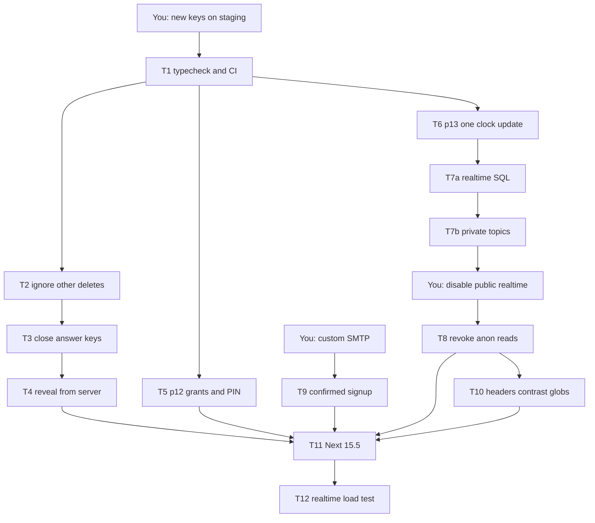

# Qlash remediation execution

The audit in [REMEDIATION-Qlash-90e7929.md](c:\Users\ASUS\development\PowerPointer\REMEDIATION-Qlash-90e7929.md) is accurate against the live tree. Qlash `main` is exactly `90e792954bee4f2ead576a2bc90b9d3f859e42af`, clean, and still contains every finding the plan names. Execute in [c:\Users\ASUS\development\qlash](c:\Users\ASUS\development\qlash). This workspace is SlidePointer and has no Qlash source.

## What the review confirmed

- One leave can kick every phone: [PlayerGameClient.tsx](c:\Users\ASUS\development\qlash\src\app\play\[sessionId]\PlayerGameClient.tsx) listens for player DELETEs with a filter Supabase does not apply.
- Answer keys leak two ways: `sanitizeAnswers` keeps `text` for `type_answer`, and [round-result/route.ts](c:\Users\ASUS\development\qlash\src\app\api\player\round-result\route.ts) never checks that the player belongs to the session it returns answers for.
- [submit-answer/route.ts](c:\Users\ASUS\development\qlash\src\app\api\submit-answer\route.ts) returns `isCorrect` and `pointsAwarded` during the live question. The phone paints the result from that body.
- PIN lookup in [join/route.ts](c:\Users\ASUS\development\qlash\src\app\api\player\join\route.ts) and [room/route.ts](c:\Users\ASUS\development\qlash\src\app\api\player\room\route.ts) uses `.maybeSingle()` with no status filter. The partial unique index in task 5 must not be applied until that filter is deployed.
- [me/route.ts](c:\Users\ASUS\development\qlash\src\app\api\player\me\route.ts) discards the presence update with `void`.
- [registerHost.ts](c:\Users\ASUS\development\qlash\src\lib\host\registerHost.ts) creates users with `email_confirm: true`.
- [hostAuth.ts](c:\Users\ASUS\development\qlash\src\lib\supabase\hostAuth.ts) trusts `getSession()` and only falls back to `getUser()`. Task 9 replaces both with `getClaims()`. `@supabase/supabase-js` 2.110.1 has that method.
- Next is `14.2.35`. There is no `typecheck` script. CI cannot see the red `tsc`.
- [.cursor/rules/qlash-growth.mdc](c:\Users\ASUS\development\qlash\.cursor\rules\qlash-growth.mdc) is `alwaysApply: true`. The first edit on the branch sets that to `false`. Leave it false until you say to restore it.
- Google sign-in uses `redirectTo`, so the task 10 `Cross-Origin-Opener-Policy: same-origin` header is compatible with the current login flow.
- `rateLimit()` already prefers the Postgres bucket and falls back to memory. Task 7b calls that helper.
- README migration list ends at step 15 (`schema-p11`). p12–p15 become steps 16–19.
- Host UI updates only `hosts.ui_locale`. The column grant in p12 matches that. `addQuestionTime` callers pass 10 seconds, under the SQL cap of 300.
- `create_live_lobby` already refuses another host's quiz. The new trigger is a second check on direct inserts. `auth.uid()` is set on that path.

## Rules for every coding session

Paste the audit's Master Context at the top of the session. Then:

- Branch `security/remediation` from `90e7929`. One commit per task: `sec(T<n>): 
`.
- Edit only the files that task names. Anchor on the behavior described there; line numbers have already drifted by a few lines.
- New SQL goes in the new file the task names. Mirror the final state into [schema.sql](c:\Users\ASUS\development\qlash\schema.sql) as a labelled follow-up in the same commit. Leave old `schema-p*.sql` files unchanged.
- Use the audit SQL as written. If Postgres rejects a statement, stop and report the exact error. Do not invent a second design.
- Keep every existing `expect()` unless the task lists that test under "Authorized test changes".
- Local gate before any "done": `pnpm typecheck && pnpm lint && pnpm test && pnpm build`. After task 1, the test count may only rise from the task 1 baseline.
- Stop at the first failing gate. Print files changed, the migration filename, and the verbatim gate output.
- Never read, print, or commit the leaked service-role key, emails, or project secrets.

## Sequence

Run the tasks in that order on one branch. Task 10 waits until task 8 so its class-name sweep does not collide with the player and host client edits in tasks 2, 4, and 7b.

## Your steps, before the agent starts

1. Create a staging Supabase project and point a Vercel preview at it. Apply `schema.sql` and migrations in the README order through p11.
2. On staging, create the new publishable and secret keys and put them in Preview env and your local `.env.local`. Smoke-test one lobby. Leave production legacy keys in place until the branch is deployed and class is over.
3. Create `TEST_HOST_EMAIL`, `TEST_HOST_PASSWORD`, and `FOREIGN_QUIZ_ID` in the shell only.
4. Run the leaked-key check from task 0 yourself. A `401` means the old key is dead. The agent does not run that command.

Production key disable and JWT revoke stay last, outside class hours, after the new keys are deployed.

## Agent tasks

**T1 — typecheck.** Widen [src/test/supabaseMock.ts](c:\Users\ASUS\development\qlash\src\test\supabaseMock.ts) so the 16 test-file `tsc` errors clear. Add `pnpm typecheck` and a CI step in [.github/workflows/test.yml](c:\Users\ASUS\development\qlash\.github\workflows\test.yml). Record the passing test count. A throwaway type error in `src/lib/utils.ts` must fail the Action; revert that commit.

**T2 — C3.** Add `isOwnRemoval` and call it first in the player DELETE handler. Deploy this before any later realtime work. Manual: two rooms, Leave on phone A, phone B stays. If phone B already stays before the fix, stop and report it.

**T3 — H1 and H2.** `toPublicAnswers` returns `[]` for `type_answer`. Rewrite round-result so the player row must match `session_id`, the question must belong to that quiz, and its index must be `<= current_question_index` while status is reveal, leaderboard, or finished. Add `was_late` to the submission payload. Existing tests may gain mock rows only.

**T4 — H3 on the phone.** Submit responses become `{ success, duplicate, message }`. The reveal card shows "Checking your answer…" and paints Correct, late-correct, Missed, or Time's up only from round-result. A failed fetch shows `resultUnavailable` and plays no sound. This task starts only after T3 is green.

**T5 — p12.** Ship the `.neq('status','finished')` PIN filters and their tests first. Then add [schema-p12-hardening.sql](c:\Users\ASUS\development\qlash\schema-p12-hardening.sql) and [scripts/security/check-grants.mjs](c:\Users\ASUS\development\qlash\scripts\security\check-grants.mjs) exactly as specified. You apply the SQL on staging after the code is deployed. Expect 5 FAIL lines before, 5 PASS lines after. The privilege query in the audit includes `consume_rate_limit`; that function is already revoked in p4. If the result differs, stop. Also sign up a new Google host on staging and join a live PIN that a finished game already used.

**T6 — p13.** Add the five clock RPCs. [game.ts](c:\Users\ASUS\development\qlash\src\app\actions\game.ts) calls them and keeps today's return shapes: pause stays `{ success: true }`, resume and add-time still return `serverStartedAt`, add-time still returns `addedSeconds`. `goToNextQuestion` still calls `applyScoresBeforeAdvance` before `advance_question`. Delete `stampQuestionClock` only. A direct RPC can still skip scoring; that is the residual of the SQL as written, and the server action must keep the score call. Staging: one Next click increments `n_tup_upd` by 1. Pause with 7 seconds left, wait, resume, both screens show 7.

**T7a — realtime SQL, no client change.** Confirm `realtime.send`, `realtime.topic`, and RLS on `realtime.messages` before writing the file. Add [schema-p14-realtime-auth.sql](c:\Users\ASUS\development\qlash\schema-p14-realtime-auth.sql) and [scripts/security/realtime-probe.mjs](c:\Users\ASUS\development\qlash\scripts\security\realtime-probe.mjs). Public access stays on. A current game must play exactly as it does today. Probe line 4 stays `SUBSCRIBED` until 7c.

**T7b — client switch.** Players subscribe to private `session:<id>`, handle `session:state` and `player:removed`, and POST reactions to `/api/player/react`. They send nothing on Realtime. Host and clicker use `session:<id>:host`. Delete the unused `question:reveal`, `timer:sync`, and `multiplier:change` sends. Keep the question hydrate watchdog. Play a full 3-question game on the preview, including pause, +10s, multiplier, announcement, kick, and leave. A phone that misses a status event and stays on the old screen is a stop: report it, and do not invent a second channel.

**T7c — you.** Deploy 7b to production, confirm the same manual game, then disable "Allow public access". Re-run the probe: legacy public topic is `CHANNEL_ERROR`, and a spoof loop never shows "SPOOF" on a real phone.

**T8 — p15.** Grep first. A browser client that still reads `players` or `game_sessions` is a stop. Then revoke anon SELECT and drop the two anon policies. Realtime probe line 1 stays `SUBSCRIBED` because the policy helpers are security definer. Reports and a full game still work.

**T9 — after custom SMTP and Confirm email are on.** Delete the pre-confirm register route. Sign-up uses `signUp` plus [src/app/auth/confirm/route.ts](c:\Users\ASUS\development\qlash\src\app\auth\confirm\route.ts). `readHostAuth` uses `getClaims()` only. The pre-takeover test is yours: unconfirmed password signup, then Google on the same email, then the password must fail. If SMTP is not ready, stop. The Google-only alternative in the audit is the fallback, and only if you choose it.

**T10 — four commits.** Await the presence update. Add the headers from the audit, including report-only CSP. Raise the listed text opacities only. Fix Tailwind content globs to `app`, `components`, `lib`, and `hooks`. Play one game with the console open and keep any CSP report lines.

**T11 — last code change.** Newest `15.5.x` that is at least `15.5.28`, plus React 19. Await `cookies()`, `headers()`, `params`, and `searchParams`. Keep every `force-dynamic`. `pnpm audit --prod` ends at 0 critical and 0 high. Then repeat the two-room leave test, the slow-3G reveal test, and `realtime-probe.mjs`.

**T12.** Add `scripts/scale-realtime.mjs` and a Security section to the README. You run 80 clients on the plan production uses, during a real 3-question game. All clients receive every `session:state` and `question:start`, p95 spread under 1 second, and the Realtime log shows no tenant cap errors.

## Bring-back points

After T2, T5, T7c, T9, and T11, the review packet is the branch SHA, the verbatim gate output, and any SQL line Postgres forced the agent to change.
